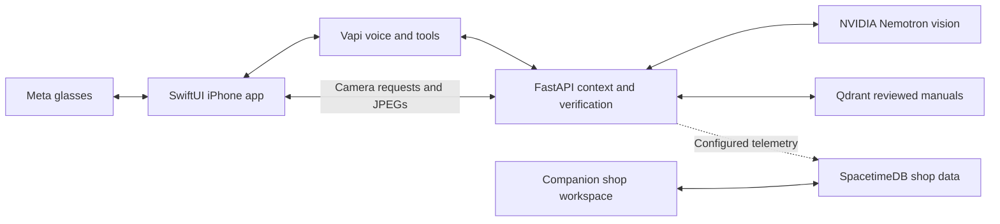

<div align="center">

# CARVIS

**Conversational Automotive Repair & Visual Intelligence System**

### Eyes on the job. Answers in your ear.

A hands-free automotive copilot built with Meta smart glasses, NVIDIA Nemotron, verified service-manual retrieval, and SpacetimeDB.

**Built at [HackUTD 2026](https://hackutd-zeroday.devpost.com/)**


</div>

## Why CARVIS

A mechanic shouldn't have to stop fixing a car just to find the information they need. CARVIS was inspired by a mechanic who had to put down his tools, wash his hands, and search ALLDATA at the shop computer whenever he needed a specification.

CARVIS brings the question and answer into the job through **Meta Ray-Ban glasses and a native SwiftUI iPhone app**.

> “Hey CARVIS, what is the tolerance on the ride height of the vehicle?”

Our physical-glasses demonstration shows vehicle confirmation, a matching reviewed manual lookup, and a spoken answer without reaching for the phone.

## Platform capabilities

| Capability | Implementation |
| --- | --- |
| **SEE** | NVIDIA Nemotron interprets captured images and returns likely components, visual context, and uncertainty. |
| **VERIFY** | Qdrant retrieves structured manual records; Python checks vehicle applicability, variants, reviewed evidence, and conflicting values before formatting specifications. |
| **CONNECT** | SpacetimeDB provides profiles, shops, roles, invitations, and shared query/result records in the companion shop workspace. |
| **CONVERSE** | Vapi and GPT-4.1-mini coordinate voice and tools, with confirmed vehicle context and conversational follow-ups. |

The camera-command pipeline correlates fresh captures with active sessions and handles deadlines, duplicates, and stale results. LlamaParse-assisted ingestion uses content-hash caching, source provenance, and review before specifications become available.

**The model interprets the question. The manual supplies the specification.**

## Architecture



Nemotron handles visual interpretation; the conversational model selects tools. Qdrant stores manual evidence; SpacetimeDB organizes shared shop activity.

## Quick start

Requirements: Python 3.12 recommended, service credentials, and reviewed Qdrant v2 records. The native app also requires Xcode, a physical iPhone, compatible glasses, and Meta developer setup.

From the repository root:

```bash
python3 -m venv .venv
.venv/bin/pip install -r backend/requirements.txt
cp backend/.env.example backend/.env
# Configure credentials privately in backend/.env.
cd backend
CARVIS_QDRANT_COLLECTION=carvis_specs_v2 ../.venv/bin/uvicorn main:app --port 8000
```

Expose the backend through HTTPS reachable by both the iPhone and Vapi. From the repository root, configure the assistant:

```bash
# Set VAPI_PRIVATE_KEY and VAPI_WEBHOOK_SECRET in backend/.env first.
# Set VAPI_ASSISTANT_ID to update an existing assistant.
.venv/bin/python backend/vapi_assistant.py --public-url https://YOUR-BACKEND
```

Open [the Xcode project](ios/Carvis/Carvis.xcodeproj), configure signing, Meta credentials, the backend address, and the local Vapi public key/assistant ID. Follow the [iOS setup guide](ios/README.md). Never commit credentials or captured images.

Use one backend worker while conversation state is in memory. Follow the [migration runbook](docs/qdrant-v2-migration.md) before changing collections or aliases; preserve the legacy collection.

## Repository

| Directory | Purpose |
| --- | --- |
| `ios/` | Primary SwiftUI interface, glasses integration, voice, and camera |
| `backend/` | API, Nemotron adapter, conversation tools, retrieval, ingestion, and tests |
| `carvis-module/spacetimedb/` | Shop database schema, views, and reducers |
| `frontend/` | Retained companion web workspace; not required for the glasses demo |
| `docs/` | Architecture, hardware checks, source validation, and migration |

## Validation and scope

Passed local checks: **113 backend tests, 66 conversation-state checks, and 29 wake-phrase checks**

## Documentation

[iOS setup](ios/README.md) · [Hardware checklist](docs/testing/handsfree.md) · [Architecture](docs/architecture.md) · [Source validation](docs/validation/qdrant-v2.md) · [Migration and rollback](docs/qdrant-v2-migration.md)
